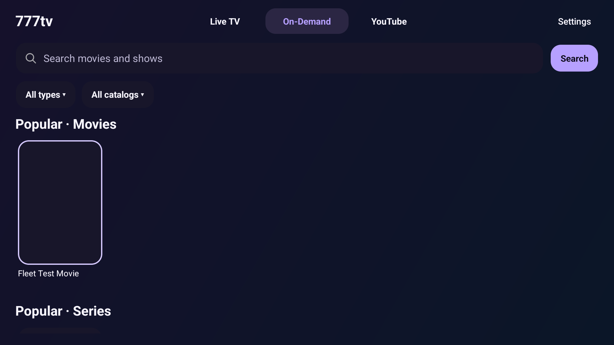
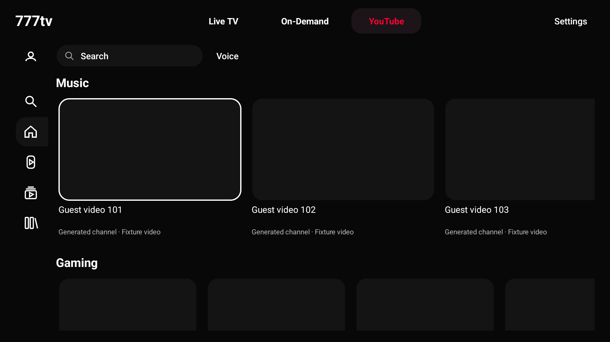
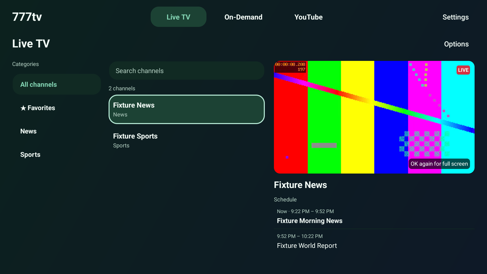

# 0.22.0 — app and section themes

Classic remains the default. Ten coordinated presets cover solid backgrounds,
subtle gradients, readable surfaces and selection/control accents. On-Demand,
YouTube and Live TV can each use an independent preset or inherit the app theme.
Settings uses the app theme; explicit Classic remains distinct from inheritance.

The [theme guide](../../docs/themes.md) explains the controls. The reviewed
examples use Cinema violet/blue-black, Tube black/white/red and Aurora dark teal.
These are actual Android TV captures using generated test content:

A separate visual-design agent refined the neutral Tube focus, darker Aurora
backdrop, recommended ordering and scope labels, then approved the final native
captures. Palette contrast is regression-tested, including red selection labels.
No wallpaper bitmaps, blur, background animation or new rendering library is added.
The APK grows 14,760 bytes from 0.21.1; artwork and encoded-media budgets are unchanged.

218 ordinary JVM tests, lint and 31 unique native TV-emulator scenarios pass.
All 63 production-file hashes match the signed candidate source. The signed
release is installed in place on the TCL; all ten real picker selections and
three independent area palettes passed. Preset commits reached the focused
Appearance row in a median 146 ms (73–158 ms, including input/probe overhead).
PSS across the short ten-change workload varied from 66.5 to 92.4 MiB and reclaimed
memory naturally; this is not a long-term leak or video FPS benchmark.

The TCL's original preferences, profiles and add-ons were restored/preserved, and
temporary test instrumentation/downloads were removed. The original appearance
remains selected; the gallery recipe is configurable in Settings → Appearance.
No real IPTV profile was provisioned, and no Google/phone account acceptance is
inferred from these checks. The [verification JSON](verification.json) records
checksums, scope, corrected findings and the physical measurements.
