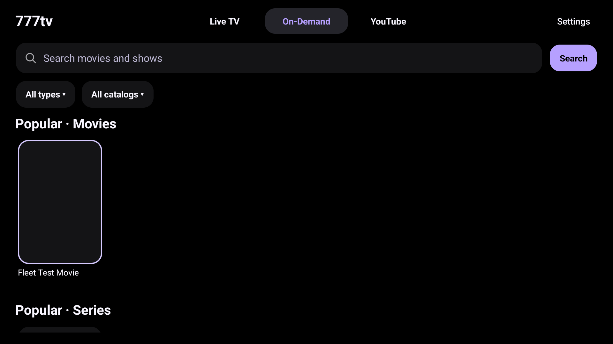

# 0.22.1 — black On-Demand with accents

Cinema now uses a true black backdrop across On-Demand, with neutral charcoal
fields/cards and violet accents for focus, selection and actions. It stays solid
when Background is set to Theme default. Layout and artwork retain their colors.

The visual designer approved the native fixture screenshot and private TCL
capture with real loaded artwork. The patch is installed on the TCL, with Cinema
selected only for On-Demand using Settings → Appearance. App/YouTube/Live and
background-option choices were preserved. Fresh installs keep the Classic default.

218 JVM tests, lint and the updated native three-area journey pass. All 63
production hashes match the signed patch; only the palette and version declaration
changed from 0.22.0. Its historical full regression record remains separate.
[Verification](verification.json) and [SHA256SUMS](SHA256SUMS) identify the patch.
