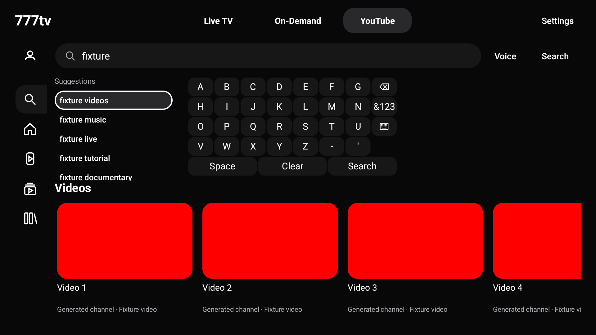
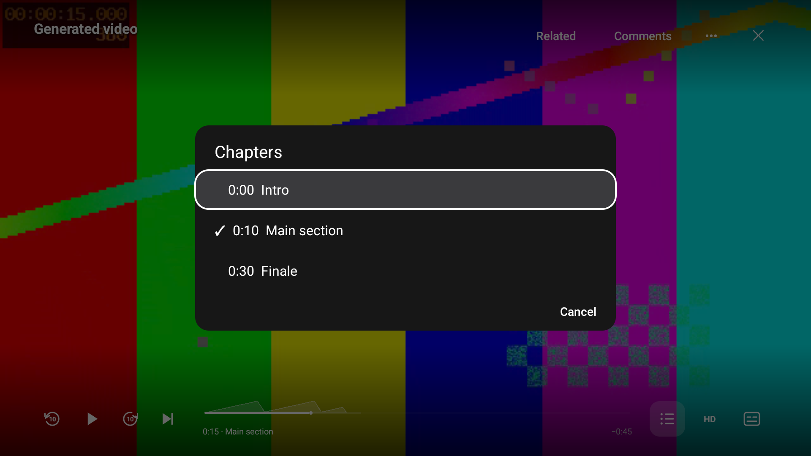

# 777tv 0.23.0

Installed in place on the TCL, retaining its UID, settings, two add-ons and zero
IPTV profiles. On-Demand keeps the black Cinema appearance with violet accents.

The three-agent review added live query suggestions, watched-thumbnail progress,
chapter navigation, a conditional Previous control and direct reply navigation.
It also fixed delayed suggestion selection focusing a retiring shelf, bounded
stalled guest recommendations, and added one source recovery attempt for rejected
YouTube media URLs. See the [parity review](../../docs/youtube-parity-0.23.md).

The signed release matches all 63 production source hashes used by the native
tests. Verification includes 236 JVM passes, three skipped opt-in probes, lint
with zero errors, and 135 unique native scenarios with passing results. Resolved
fixture assumptions and the worker restart are retained in
[verification.json](verification.json).

Five opt-in stages tested the signed release on the TCL with real public YouTube
data and media:

| Sample | Observed result |
| --- | --- |
| Suggestions | 670 ms including debounce; keyboard focus retained |
| Guest Home / search | 1.75 s / 0.93 s to usable content |
| Regular video | 2.59 s to first frame; hardware AVC, up to 1080p60 |
| Regular steady window | 30 s, zero dropped frames/rebuffers/decoder reinitializations; 74.1 MiB PSS |
| Shorts | 2.05 s first clip; next clip 1.19 s end-to-end; 20 s with zero drops/rebuffers; 63.6 MiB PSS |
| Warm repeated playback | 1.33 s and 1.25 s first frames using recent source records |
| Search remote navigation | All 18 moves delivered; warm window 1 deadline overrun in 93 frames; 51.8 MiB PSS |
| Three playback/Back cycles | Native heap returned to about 13.8 MB after each Back; explicit-GC sample labeled separately |

Comments/replies retained the same decoder. Pause-preserving seek, 170-second
held-key acceleration, release reset and HUD auto-hide passed. The artwork budget
remains 8 MiB on this device; it is separate from total process memory. These are
individual device samples, not a TizenTube speed comparison or a leak proof.
Generated native chapter markers verify chapter-menu seeking; the sampled public
chapter-metadata response had no markers.

The temporary probe and diagnostic downloads were removed. On-Demand was reopened
after cleanup. Real TV captures stay private; these native screenshots use generated
content:

Google-owned recommendation identity, owner-approved account/history behavior,
per-shelf Home filters and TizenTube's complete extension set remain different.
The app does not claim 1:1 parity. [SHA256SUMS](SHA256SUMS) identifies the APK.
