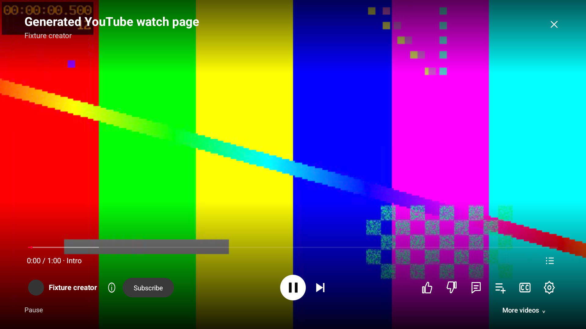
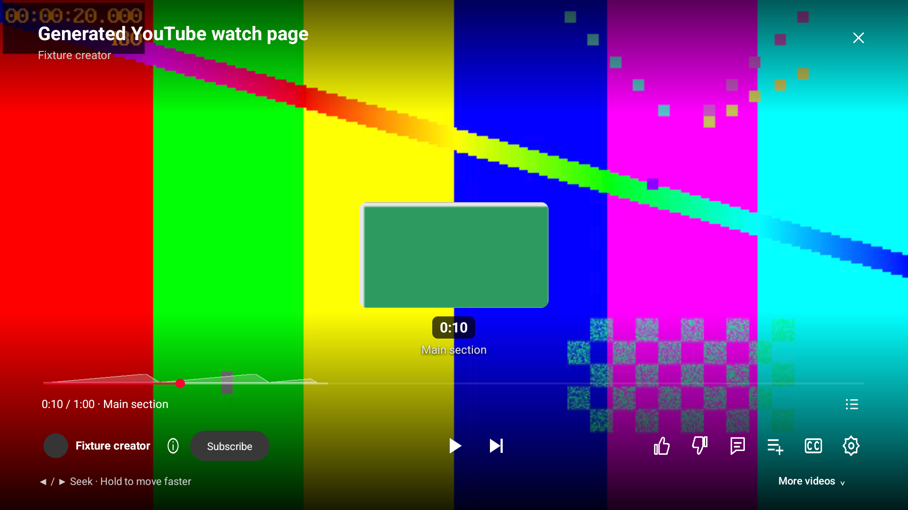

# 777tv 0.24.0 preview

YouTube playback now has a full-width thin red timeline, centered transport and
direct channel, Description, Subscribe, Like, Dislike, Comments, Save, CC and
Settings actions. Held seeking previews the position and commits once on release.
Actual optional storyboard images share the bounded artwork cache. Newer phone
and media commands supersede an unfinished remote gesture.

The change is limited to YouTube. On-Demand and IPTV Live TV keep their controls
and preferences; Shorts retain their portrait presentation. Playback remains
native Kotlin with one ExoPlayer decoder and no new library.

Verification includes 245 JVM passes, three opt-in skips, lint with no errors,
and 112 unique Android TV fixture scenarios with targeted account-test reruns.
All 67 production hashes match the selected emulator snapshots and release
inputs. The signed APK was installed in place on the TCL, pulled back and
matched; its UID and foreground session were preserved. No interactive TCL
playback or performance probe was run for this release.

These captures come from the actual native Android TV emulator with generated
media and metadata. The colored pattern and moving shapes belong to the test
video, not the interface. They contain no real viewing history or accounts.

[Verification](verification.json) records source hashes, exact test scope,
artifact identity and device deployment. [SHA256SUMS](SHA256SUMS) identifies
`777tv-0.24.0-preview.apk`. The [player review](../../docs/youtube-player-0.24.md)
explains the reference layout and remote behavior.
